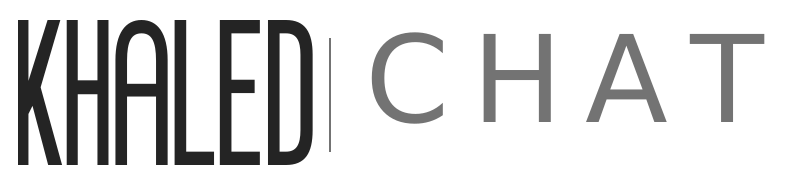

  

<b>Your AI. Your Device. Your Privacy.</b> 
Local, private AI chat for Windows. Free and open source. 
<a href="https://khaledchat.io">khaledchat.io</a>

## What it is

Khaled Chat runs open-weight AI models (GGUF, via [node-llama-cpp](https://github.com/withcatai/node-llama-cpp)) on your own computer.
- **No account, subscription or cloud AI service.** Chats, files and models stay on your computer.
- **Nothing is downloaded without your OK.** Each model or optional component asks first, showing its size, source, destination and license.
- **Web access is off by default.**

> **Status: release candidate in development.** Not yet published or signed. See [RELEASE_CHECKLIST.md](RELEASE_CHECKLIST.md) for open blockers.

## Based on Hob

Khaled Chat is a fork of [Hob](https://github.com/FrigadeHQ/hob) by Frigade (MIT License). Hob's copyright notice is kept in [LICENSE](LICENSE).
- The unmodified upstream is tagged `hob-baseline-0.2.6`.
- Hob's original README is in [docs/HOB-UPSTREAM-README.md](docs/HOB-UPSTREAM-README.md).

## Requirements

- **System:** Windows 10 or 11, 64-bit (x64). Development and tests ran on Windows 10 22H2. Windows 11 is untested.
- **Memory:** 8 GB RAM or more. Small models (about 1–2 GB files) are the realistic choice at 8 GB.
- **Disk:** free space for the models you choose (1–20 GB each).
- **Graphics:** optional. The engine uses CUDA or Vulkan when available, otherwise the processor.

## Documentation

- [ARCHITECTURE.md](ARCHITECTURE.md): how the app is put together
- [DEVELOPMENT.md](DEVELOPMENT.md): setting up and working on it
- [BUILDING.md](BUILDING.md): building the app and the installer
- [TESTING.md](TESTING.md): tests and latest results
- [PRIVACY.md](PRIVACY.md): what stays local, and every permitted network use
- [THIRD_PARTY_NOTICES.md](THIRD_PARTY_NOTICES.md): licenses
- [CHANGELOG.md](CHANGELOG.md)
- [RELEASE_CHECKLIST.md](RELEASE_CHECKLIST.md)
- [docs/khaled-chat/](docs/khaled-chat/): milestone reports and audits
- [docs/khaled-chat/PROGRESS.md](docs/khaled-chat/PROGRESS.md): progress log
